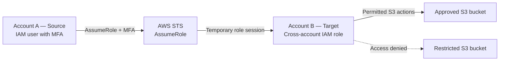

# AWS IAM Cross-Account Access with Least Privilege

A hands-on AWS security project demonstrating MFA-protected cross-account role assumption and bucket-level Amazon S3 permissions across two AWS accounts.

## Project Objectives

- Configure cross-account IAM role assumption between two AWS accounts.
- Require MFA when the source IAM user assumes the target role.
- Restrict S3 data access to one approved bucket.
- Allow the user to see bucket names without granting access to every bucket.
- Validate allowed and denied access scenarios.

## Architecture



Account IDs are omitted from this public documentation. Replace placeholder account IDs in the example policies before using them in your own environment.

## Implemented Configuration

### Source Account — Account A

- IAM user: `Revanth`
- MFA configured.
- Identity policy permits `sts:AssumeRole` only on the intended target role.

### Target Account — Account B

- IAM role: `Cross-account-access-to-account-B-from-A`
- Trust policy allows the intended source IAM user to assume the role when MFA is present.
- S3 permissions allow bucket discovery and selected operations on the approved bucket.

## Trust Policy

Replace `<SOURCE_ACCOUNT_ID>` with your source account ID.

```json
{
  "Version": "2012-10-17",
  "Statement": [
    {
      "Sid": "AllowSourceUserWithMFA",
      "Effect": "Allow",
      "Principal": {
        "AWS": "arn:aws:iam::<SOURCE_ACCOUNT_ID>:user/Revanth"
      },
      "Action": "sts:AssumeRole",
      "Condition": {
        "Bool": {
          "aws:MultiFactorAuthPresent": "true"
        }
      }
    }
  ]
}
```

## Source User Permission Policy

Replace `<TARGET_ACCOUNT_ID>` with the target account ID.

```json
{
  "Version": "2012-10-17",
  "Statement": [
    {
      "Sid": "AssumeSpecificTargetRole",
      "Effect": "Allow",
      "Action": "sts:AssumeRole",
      "Resource": "arn:aws:iam::<TARGET_ACCOUNT_ID>:role/Cross-account-access-to-account-B-from-A"
    }
  ]
}
```

## Target Role S3 Permissions Policy

This policy allows the user to see bucket names, list the approved bucket, and perform selected object operations in that bucket.

```json
{
  "Version": "2012-10-17",
  "Statement": [
    {
      "Sid": "AllowListingBucketNames",
      "Effect": "Allow",
      "Action": "s3:ListAllMyBuckets",
      "Resource": "*"
    },
    {
      "Sid": "AllowApprovedBucketListing",
      "Effect": "Allow",
      "Action": [
        "s3:ListBucket",
        "s3:GetBucketLocation"
      ],
      "Resource": "arn:aws:s3:::amazon-s3-bucket-cross-account-access"
    },
    {
      "Sid": "AllowApprovedBucketObjects",
      "Effect": "Allow",
      "Action": [
        "s3:GetObject",
        "s3:PutObject",
        "s3:DeleteObject"
      ],
      "Resource": "arn:aws:s3:::amazon-s3-bucket-cross-account-access/*"
    }
  ]
}
```

**Important:** `s3:ListAllMyBuckets` permits discovery of bucket names; it does not grant access to every bucket's contents. The restricted bucket remains inaccessible when no other applicable policy grants access.

## Validation Results

| Test | Expected result | Status |
|---|---|---|
| Sign in with MFA | Successful authentication | Passed |
| Assume target role | Role switch succeeds | Passed |
| View S3 bucket names | Both bucket names visible | Passed |
| Open approved bucket | Access allowed | Passed |
| View approved bucket objects | Objects visible | Passed |
| Open restricted bucket | Access denied | Passed |

These results reflect the behavior observed during the lab. Add sanitized screenshots to support the results.

## How to Reproduce

1. Use two separate AWS accounts.
2. Create the source IAM user and configure MFA.
3. Create the target IAM role and configure its trust policy.
4. Attach the narrowly scoped `sts:AssumeRole` policy to the source user.
5. Create the approved and restricted S3 buckets in the target account.
6. Attach the S3 permissions policy to the target role.
7. Switch roles from the source account into the target account.
8. Verify approved-bucket access and restricted-bucket denial.

S3 bucket names are globally unique, so choose different names when reproducing this lab in another account.

## Security Decisions and Lessons Learned

- **Temporary credentials:** role assumption avoids relying on long-lived access keys for cross-account access.
- **MFA enforcement:** the trust policy requires MFA for role assumption.
- **Scoped trust:** only the intended source IAM user is trusted.
- **Least privilege:** object permissions are restricted to the approved bucket.
- **Discovery versus data access:** listing bucket names is separate from listing or reading bucket objects.
- **Implicit deny:** actions without an applicable allow are denied unless another applicable policy grants access.

This is a learning lab, not a production-ready multi-account environment. Production deployments should also consider federation or IAM Identity Center, centralized logging, organizational guardrails, and periodic access reviews.

## Evidence and Future Improvements

- [ ] Add a sanitized architecture diagram.
- [ ] Add screenshots of successful role assumption.
- [ ] Add approved-bucket access evidence.
- [ ] Add restricted-bucket Access Denied evidence.
- [ ] Review CloudTrail events for role assumption.
- [ ] Configure S3 data events if object-level auditing is required.
- [ ] Use IAM Policy Simulator to test additional actions and document the actual results.
- [ ] Review and remove unnecessary permissions.

## References

- [AWS: Cross-account role access](https://docs.aws.amazon.com/IAM/latest/UserGuide/tutorial_cross-account-with-roles.html)
- [AWS: IAM policy evaluation logic](https://docs.aws.amazon.com/IAM/latest/UserGuide/reference_policies_evaluation-logic.html)
- [AWS: CloudTrail Event history](https://docs.aws.amazon.com/awscloudtrail/latest/userguide/view-cloudtrail-events.html)
- [AWS: Logging Amazon S3 data events](https://docs.aws.amazon.com/AmazonS3/latest/userguide/cloudtrail-logging-s3-info.html)
