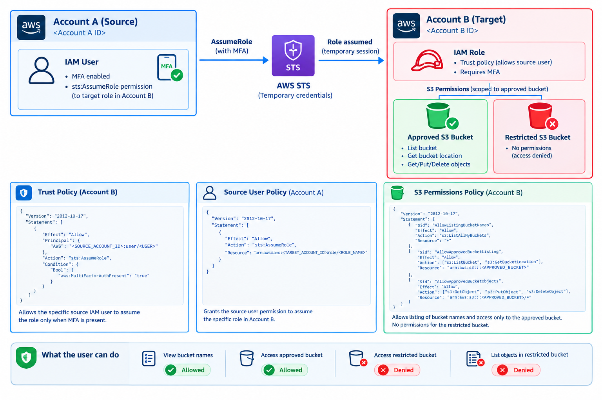
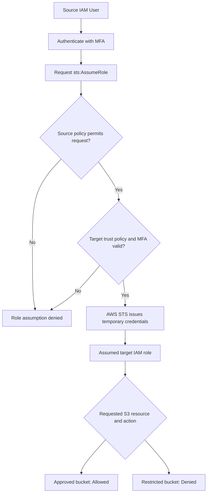

# AWS IAM Cross-Account Access with MFA

## Project Overview

This project demonstrates secure cross-account access between two AWS accounts using AWS Identity and Access Management (IAM), AWS Security Token Service (STS), and Amazon Simple Storage Service (Amazon S3).

The implementation uses an MFA-protected role-assumption workflow and least-privilege permissions to control access to resources in a separate AWS account.

**Key features**
- Cross-account IAM role assumption.
- MFA enforcement through an IAM role trust policy.
- Temporary security credentials through AWS STS.
- Least-privilege permissions for S3 resources.
- Controlled bucket discovery and object-level operations.
- Validation of permitted and restricted access.

## Architecture Diagram



*The diagram uses generic account, user, role, and bucket labels to avoid exposing actual resource names.*

## Architecture Overview

The solution consists of two AWS accounts connected through AWS STS.

### Account A — Source Account

The source account contains an IAM user with MFA enabled.

- The user authenticates to the source account.
- An identity-based policy permits `sts:AssumeRole` on the specific target role.
- The user requests access to the target account by assuming that role.

### AWS Security Token Service (STS)

AWS STS enables the source user to obtain temporary credentials for the target role.

- Receives the role-assumption request.
- Evaluates the source user's permission and the target role's trust policy.
- Issues temporary credentials when the request is authorized.

### Account B — Target Account

The target account contains the IAM role that provides controlled access to S3 resources.

- The trust policy specifies the permitted source principal.
- The trust policy requires MFA to be present.
- The role's permissions policy determines which S3 actions and resources are accessible.

### Amazon S3 Access Control

The assumed role has different effective access outcomes for two buckets:

| Resource | Expected outcome |
|---|---|
| Approved S3 bucket | Listing and configured object operations are allowed |
| Restricted S3 bucket | Access is denied when no applicable permission grants access |
| S3 bucket-name discovery | Allowed through `s3:ListAllMyBuckets` |

Bucket names may be visible during discovery even when the role cannot access a bucket's contents. Bucket visibility does not mean that the role has permission to read its objects.

## Authentication and Authorization Flow



## Repository Structure

```text
01-iam-cross-account-access/
├── README.md
├── architecture/
│   └── architecture-diagram.png
├── policies/
│   ├── trust-policy.json
│   ├── source-user-policy.json
│   └── target-role-s3-policy.json
└── evidence/
    ├── 01-mfa-enabled.png
    ├── 02-successful-role-switch.png
    ├── 03-approved-bucket-access.png
    └── 04-restricted-bucket-denied.png
```

## IAM Policies

The project separates role trust, source-user permissions, and target-role resource permissions.

### 1. Trust Policy

**File:** `policies/trust-policy.json`

Defines which source principal can assume the target IAM role. The policy uses the `sts:AssumeRole` action and the `aws:MultiFactorAuthPresent` condition to require MFA.

### 2. Source User Policy

**File:** `policies/source-user-policy.json`

Grants the source IAM user permission to assume the specific target role. This follows least privilege by avoiding unrestricted role assumption across AWS resources.

### 3. Target Role S3 Policy

**File:** `policies/target-role-s3-policy.json`

Defines the S3 permissions available to the assumed role.

- `s3:ListAllMyBuckets` permits discovery of bucket names.
- `s3:ListBucket` and `s3:GetBucketLocation` permit the configured bucket-level operations on the approved bucket.
- `s3:GetObject`, `s3:PutObject`, and `s3:DeleteObject` permit the configured object operations on the approved bucket.
- No permissions are granted by this policy for the restricted bucket.

Actual access is determined by all applicable AWS authorization controls, including explicit denies, resource policies, permissions boundaries, session policies, and organizational policies.

## Implementation Steps

1. Enabled MFA for the source IAM user.
2. Created the target IAM role in the second AWS account.
3. Configured the role trust policy to trust the intended source principal and require MFA.
4. Attached an identity-based policy to the source user allowing assumption of the specific target role.
5. Attached the scoped S3 permissions policy to the target role.
6. Configured the approved and restricted S3 buckets for access validation.
7. Assumed the target role using the AWS console.
8. Tested bucket discovery, approved bucket access, and restricted bucket access.
9. Captured screenshots to document the test results.

## Security Controls Demonstrated

| Security control | Purpose |
|---|---|
| MFA enforcement | Requires MFA for the role-assumption request |
| Cross-account trust | Defines the permitted source principal |
| Least privilege | Restricts the source user's role-assumption permission |
| Temporary credentials | Uses AWS STS instead of long-lived credentials for assumed-role access |
| Resource-level permissions | Limits S3 operations to the approved bucket |
| Access validation | Verifies allowed and denied operations |

## Testing and Validation

The following results reflect the implemented lab configuration and its observed behavior.

| Test case | Result |
|---|---|
| MFA configured for source user | Passed |
| Switch to target IAM role | Passed |
| View S3 bucket names | Passed |
| Access approved S3 bucket | Passed |
| Access restricted bucket contents | Denied as expected |

## Evidence and Screenshots

Screenshots are available in the `evidence/` directory.

| Evidence file | What it demonstrates |
|---|---|
| `01-mfa-enabled.png` | MFA configuration for the source user |
| `02-successful-role-switch.png` | Successful assumption of the target role |
| `03-approved-bucket-access.png` | Successful access to the approved bucket |
| `04-restricted-bucket-denied.png` | Denied access to the restricted bucket |

## Key Learnings

Through this project, I gained hands-on experience with:

- AWS IAM users, roles, trust policies, and identity-based policies.
- Cross-account access and role assumption.
- MFA conditions in IAM trust policies.
- AWS STS and temporary security credentials.
- Amazon S3 bucket-level and object-level permissions.
- Least-privilege access design.
- Validation of effective permissions through positive and negative testing.
- Documenting cloud security configurations and test evidence.

## Future Enhancements

- Manage cross-account access through AWS IAM Identity Center.
- Introduce AWS Organizations and service control policies.
- Enable AWS CloudTrail monitoring and investigate role-assumption events.
- Automate IAM policy validation and security checks.
- Add infrastructure-as-code deployment using AWS CloudFormation or Terraform.
- Implement continuous security checks in a CI/CD pipeline.

## Disclaimer

This project was created for educational and professional portfolio purposes in an AWS learning environment. Account identifiers and resource names are generalized in the published documentation. No passwords, access keys, secret keys, session tokens, or other credentials should be committed to the repository.

---

**Project focus:** AWS IAM · Cross-Account Access · MFA · AWS STS · Amazon S3 · Least Privilege · Cloud Security
